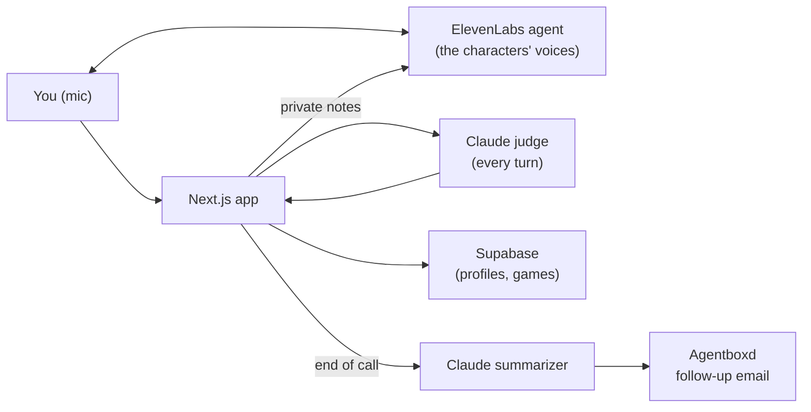

<p align="center">
  
</p>

# Suspeeches

A voice game where you larp your way through social situations: a recruiter screen, a networking mixer, a startup interview panel, or any scene and characters you write yourself. You save your real profile, pick what you'll fake, then talk out loud to AI characters who only know your cover story. A hidden judge knows the truth, and every character's suspicion of you shows over their head.

<p align="center">
  
  
  
  
  
  
  
  
  
  
  
</p>

> [!NOTE]
> Built at **LarpHacks**. Everyone you meet in the game is made up, and so is the job. It's for practice and fun only, so please don't larp on real people.

## The problem

Holding a story together under follow-up questions is a real skill, whether it's an interview, a networking chat or a room full of strangers, and the only place to practice it is the real thing, where a slip costs you. Suspeeches gives you a safe place to try: characters who push back like real people, and a debrief that tells you exactly which answer gave you away.

## How it fits together



The characters are ElevenLabs agents with their own speech-to-text, language model and voice. They only ever see your cover story. Group scenes use one multi-voice agent that tags each character's lines, so the app knows whose face to move.

After each of your turns, a Claude judge reads your real profile, your cover story, the transcript and your timing (pauses, filler words, speaking speed) and returns a suspicion change for each listener. The server validates it, applies the scoring rules, and quietly passes the next question and the character's new mood back to the agent. The characters never mention numbers. When the call ends, a second Claude call writes the debrief, and the character emails you an in-character follow-up.

## How suspicion works

Suspicion starts at 20 for every character. Specific answers lower it, vague ones and dodges raise it, and contradictions or long silences raise it for everyone. Each character judges what they know: in the panel, Maya catches engineering claims and Jordan catches design ones. The bigger the gap between the real you and your cover story, the faster suspicion moves, and the higher your score multiplier.

| Over their head | Suspicion | How they sound |
|---|---|---|
| Buying it | under 35 | Warm |
| Curious | 35–59 | Curious, asks for detail |
| Skeptical | 60–79 | Pushes back |
| Onto you | 80+ | Cold |

The call ends in one of two ways: anyone hits 100 (you're caught) or the clock runs out (you made it). You can also hang up and walk out.

## What you can do

**Set up:**

- Sign up with email and password, and save your real profile once. Only the hidden judge sees it.
- Pick a scene: Dana's recruiter screen, a networking chat with Priya, the startup interview with Maya, Theo and Jordan, or write your own character or group.
- Write your cover story, or get claims suggested from your profile. Save it to see your larp gap.
- Choose 1, 5 or 10 minutes.

**Play:**

- Talk on a video-call screen, with one tile per character and their status and suspicion over their head.
- Watch faces change as they get suspicious. Whoever is talking moves their mouth, and the latest line shows as a caption.

**Afterwards:**

- Read the debrief: the result and score, a suspicion timeline you can click into, claim-by-claim verdicts, three tips and the full transcript.
- Get the character's follow-up email, from an interview invite to a polite brush-off.
- See past games on your profile.

## Project structure

| Path | Role |
|---|---|
| [`src/app`](src/app) | Pages (sign-in, profile, setup, scene, debrief) and the API routes |
| [`src/components`](src/components) | Call screen, scene runner, faces, timeline, transcript and the theme kit |
| [`src/lib`](src/lib) | Judge, scoring, larp gap, summarizer, sessions, ElevenLabs and email |
| [`prompts`](prompts) | Versioned prompts for the judge, gap, summarizer, follow-up and every character |
| [`scripts`](scripts) | Creates and updates the ElevenLabs agents, and tests the judge |

## Run it locally

You need Node.js 20 or newer, plus API keys for Anthropic and ElevenLabs. Supabase (accounts) and Agentboxd (emails) are optional.

Copy `.env.example` to `.env.local` and fill it in. Do not commit `.env.local`.

```bash
npm install
npm run agents:create   # once: creates the five ElevenLabs agents and prints their IDs
npm run dev             # http://localhost:3000
```

Paste the printed `ELEVENLABS_AGENT_ID_*` lines into `.env.local`. After editing a character in `prompts/npc`, run `npm run agents:update` to push the change.

```bash
npm run typecheck
npm run lint
npm run test:judge
```

> [!TIP]
> To look around without any keys, run `npm run dev:mock`. The judge and debrief are canned, the characters speak with your browser's voice, and you type instead of talking.

> [!IMPORTANT]
> Browsers only allow the microphone over HTTPS or on localhost. On Render, keep a single instance, since live sessions are kept in memory.

## Scope and limitations

- Delivery is judged from the transcript and timing, not from your actual voice, so tone and confidence only count through what you say and how fast.
- Live sessions live in memory, so a server restart drops calls in progress. Finished games are saved to Supabase.
- Group scenes are one agent playing several voices, so characters can occasionally talk over each other or take a beat to hand off.
- The judge is a language model. It can be wrong, and the scores are a game, not an assessment.
