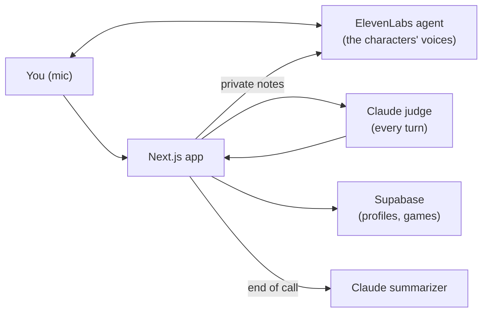

<p align="center">
  
</p>

# Suspeeches

A voice game where you larp your way through social situations: a recruiter screen, a networking mixer, a startup interview panel, or any scene and characters you write yourself. You save your real profile, pick what you'll fake, then talk out loud to AI characters who only know your cover story. A hidden judge knows the truth, and every character's suspicion of you shows over their head.

<p align="center">
  
  
  
  
  
  
  
  
  
  
</p>

> [!NOTE]
> Built at **LarpHacks**. Everyone you meet in the game is made up, and so is the job. It's for practice and fun only, so please don't larp on real people.

## The problem

Holding a story together under follow-up questions is a real skill, whether it's an interview, a networking chat or a room full of strangers, and the only place to practice it is the real thing, where a slip costs you. Suspeeches gives you a safe place to try: characters who push back like real people, and a debrief that tells you exactly which answer gave you away.

## How it fits together



The characters are ElevenLabs agents with their own speech-to-text, language model and voice. They only ever see your cover story. Group scenes use one multi-voice agent that tags each character's lines, so the app knows whose face to move.

After each of your turns, a Claude judge reads your real profile, your cover story, the transcript and your timing (pauses, filler words, speaking speed) and returns a suspicion change for each listener. The server validates it, applies the scoring rules, and quietly passes the next question and the character's new mood back to the agent. The characters never mention numbers. When the call ends, a second Claude call writes the debrief.

## How suspicion works

Suspicion starts at 20 for every character. Specific answers lower it, vague ones and dodges raise it, and contradictions or long silences raise it for everyone. Each character judges what they know: in the panel, Maya catches engineering claims and Jordan catches design ones. The bigger the gap between the real you and your cover story, the faster suspicion moves, and the higher your score multiplier.

| Over their head | Suspicion | How they sound |
|---|---|---|
| Buying it | under 35 | Warm |
| Curious | 35–59 | Curious, asks for detail |
| Skeptical | 60–79 | Pushes back |
| Onto you | 80+ | Cold |

The call ends in one of two ways: anyone hits 100 (you're caught) or the clock runs out (you made it). You can also hang up and walk out.

## What you can do

**Set up:**

- Sign up with email and password, and save your real profile once. Only the hidden judge sees it.
- Pick a scene: Dana's recruiter screen, a networking chat with Priya, the startup interview with Maya, Theo and Jordan, or write your own character or group.
- Write your cover story, or get claims suggested from your profile. Save it to see your larp gap.
- Choose 2.5, 5 or 10 minutes.

**Play:**

- Talk on a video-call screen, with one tile per character and their status and suspicion over their head.
- Watch faces change as they get suspicious. Whoever is talking moves their mouth.

**Afterwards:**

- Read the debrief: the result and score, a suspicion timeline you can click into, claim-by-claim verdicts, three tips and the full transcript.
- See past games on your profile.

## Project structure

| Path | Role |
|---|---|
| [`src/app`](src/app) | Pages (sign-in, profile, setup, scene, debrief) and the API routes |
| [`src/components`](src/components) | Call screen, scene runner, faces, timeline, transcript and the theme kit |
| [`src/lib`](src/lib) | Judge, scoring, larp gap, summarizer, sessions and ElevenLabs |
| [`prompts`](prompts) | Prompts for the judge, gap, summarizer and every character, compiled into `src/lib/prompts.generated.ts` |
| [`scripts`](scripts) | Creates and updates the ElevenLabs agents |
| [`supabase`](supabase) | Database schema and row-level-security policies for profiles and games |

## Run it locally

You need Node.js 22, plus API keys for Anthropic and ElevenLabs. Supabase (accounts) is optional.

Copy `.env.example` to `.env.local` and fill it in. Do not commit `.env.local`.

For accounts, create a Supabase project, run [`supabase/schema.sql`](supabase/schema.sql) in its SQL editor, and set `NEXT_PUBLIC_SUPABASE_URL`, `NEXT_PUBLIC_SUPABASE_PUBLISHABLE_KEY` and the server-only `SUPABASE_SECRET_KEY` (only the server saves games, so players can read their history but can't write scores into it). The row-level-security policies in that file are what keep each player's profile and history private, so don't skip them.

```bash
npm install
npm run agents:create   # only for your own ElevenLabs account: creates the agents, records them in src/lib/agents.json
npm run dev             # http://localhost:3000
```

The agent IDs are committed in [`src/lib/agents.json`](src/lib/agents.json). They aren't secret: the agents are private, so starting a conversation needs a token minted with your API key. There's nothing to paste. If you use your own ElevenLabs account, `npm run agents:create -- --force` makes new agents and rewrites the file.

### Adding a scenario

Every scenario is one entry in [`src/lib/scenarios.ts`](src/lib/scenarios.ts): its label, character, blurb, goal, avatar and agent name. The zod schema, setup screen, health check and agent script all read it. To add one:

1. Add the entry to `SCENARIOS`.
2. Write `prompts/npc/<id>.md`: the character sheet, with `voice_id`, `llm` and `first_message` (plus `voices` for a multi-voice panel) in its frontmatter. Typecheck fails until it exists.
3. Run `npm run agents:create <id>` and commit `src/lib/agents.json`.

### Prompts

Every prompt is a Markdown file in `prompts/`. `npm run prompts` compiles them into `src/lib/prompts.generated.ts` (this also runs before `dev`, `build`, `typecheck` and `test`, and `next dev` recompiles when a file changes). Code renders prompts by name, so a wrong prompt name or a missing `{{variable}}` fails `npm run typecheck` instead of a live request.

The character prompts live only in the repo. The app builds each character's prompt and first message for every call and sends them to ElevenLabs as overrides, so editing a file in `prompts/npc` goes live on the next deploy. The agents only hold the voice, LLM and settings from each file's frontmatter: after changing those, run `npm run agents:update`. `npm run agents:check` tells you if any live agent is out of date.

Each saved game records the hash of every prompt and the model it ran on (`judge_prompt`, `judge_model` and `npc_prompt` in the `games` table). After changing `prompts/judge.md` or `JUDGE_MODEL`, run `npm run eval:judge` to check the judge still scores a fixed set of example answers in the expected ranges (`src/lib/__fixtures__/judge-evals.json`).

```bash
npm run typecheck
npm run lint
npm test             # unit tests (vitest), no API calls
npm run test:live    # the fixed judge transcript against the real JUDGE_MODEL
npm run eval:judge   # judge regression set, add -- --runs 3 for medians
```

> [!TIP]
> To look around without any keys, run `npm run dev:mock`. The judge and debrief are canned, the characters speak with your browser's voice, and you type instead of talking.

> [!IMPORTANT]
> Browsers only allow the microphone over HTTPS or on localhost. Without `SUPABASE_SECRET_KEY`, live sessions are kept in memory, so run a single instance. With it, they live in the `game_sessions` table from [`supabase/schema.sql`](supabase/schema.sql): they survive restarts and deploys, and any number of instances works.

## Deploy

The app runs on [Railway](https://railway.com), which builds it from the repo with no config file. The service settings that matter: health check path `/api/health` (timeout 120 s), restart on failure, 30 s draining so a debrief that's still being written can finish during a redeploy, and a region close to your Supabase project.

1. In Supabase, run [`supabase/schema.sql`](supabase/schema.sql), and under Authentication → URL Configuration set the Site URL to your app's URL and add `<your URL>/login` as a redirect URL.
2. In Railway, create a service from this repo and add the variables from [`.env.example`](.env.example) before the first build (the `NEXT_PUBLIC_*` ones are baked in at build time). In production set `SUPABASE_SECRET_KEY` and `APP_SECRET`. Then generate a public domain: the microphone needs HTTPS.
3. Run `npm run agents:update` so the agents accept the app's prompt overrides, then `npm run agents:check`.
4. Open `/api/health` and check that everything you configured is `true`.

## Scope and limitations

- Delivery is judged from the transcript and timing, not from your actual voice, so tone and confidence only count through what you say and how fast.
- Without `SUPABASE_SECRET_KEY`, live sessions live in memory, so a server restart drops calls in progress, and finished games aren't saved to history.
- Anything that affects the score is decided on the server: the real profile is read from Supabase, the larp gap is signed by the server, and time runs on the server's clock from the moment the call connects. Only things only the browser can hear (when you start talking, silences) come from it.
- Group scenes are one agent playing several voices, so characters can occasionally talk over each other or take a beat to hand off.
- The judge is a language model. It can be wrong, and the scores are a game, not an assessment.
